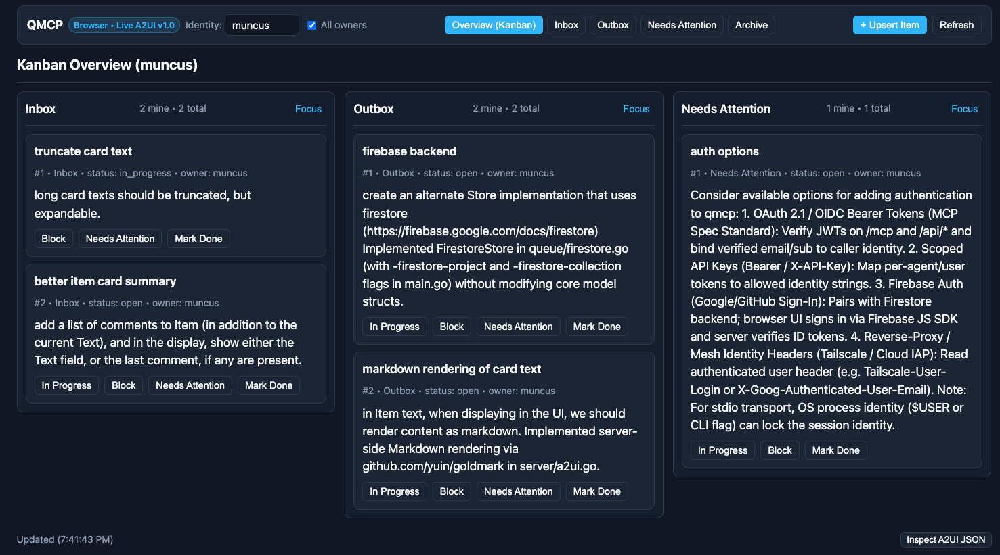

Have you ever started working with an agent, and then realized that you've
forgotten the "big picture" problem it was solving? Or maybe you're juggling a
few agents and lost track of which tab was doing which task? 😅

For a while, I solved this with a sticky note at my desk, but now I'm using a
different strategy: an agent control kanban board.

> [!TIP] TL;DR:
> I built [QMCP (Queue MCP)](https://github.com/muncus/qmcp), a
> minimalist ticketing system and MCP server that uses [A2UI](http://a2ui.org)
> embedded resources to give me a visual kanban board for queueing and
> prioritizing what my agents work on next.

I built a little service I'm calling QMCP (Queue MCP), because I wanted
somewhere to queue up ideas for my agent to tackle *next*. It has turned into a
sort of minimalist ticketing system.

## How the workflow operates


flowchart LR
    Inbox[Inbox] -->|Agent polls & assigns| InProgress[In Progress]
    InProgress -->|Completes task| Outbox[Outbox]
    InProgress -->|Stuck / needs info| NeedsAttention[Needs Attention]


Here's how I use it day-to-day:

Inbox
: I add a new task here and reorder cards to visually control what the agent will work on next.

In Progress
: My agent (typically [Google's Antigravity CLI](https://antigravity.google/product/antigravity-cli)) polls the QMCP server for work to do. It picks up the top task, marks it as in progress, assigns it to `antigravity`, and gets to work.

Outbox
: If `agy` can complete the task, it does the work, marks the task as complete, and drops it in the Outbox :tada:.

Needs Attention
: If the agent gets stuck or needs more information, it adds a comment to the item and moves it to this queue so I know to step in.

## How it's built

The core of QMCP is an [MCP](https://modelcontextprotocol.io/) server (hence the
name) -- nothing fancy there, just a couple of tools for basic CRUD operations.
New to me this time is the use of [A2UI](http://a2ui.org) **in** the MCP server.

If you're not familiar with [A2UI](http://a2ui.org), you can think of it as a
standard way to represent UI components as JSON. It was designed for agents to
generate dynamic UIs automatically from a catalog of component widgets.

So how does A2UI interact with MCP? There's an MCP server extension that lets us
specify A2UI layouts for the objects returned by our MCP server, so the agent
doesn't need to generate them on the fly. They are stored as Resources in the
MCP server and served as Embedded Resources in MCP server replies.

Why did I choose A2UI for this?

* **Exploration:** First, I wanted to explore. I'm curious to see how this new
  "contextual UI" approach feels to use in practice, and how it can serve as a
  building block for more innovation.
* **Future-proofing:** Second, I know the agent landscape is changing rapidly,
  so adopting A2UI here is my way of future-proofing the UI layer. Whatever
  comes next, I hope we can build on open protocols like MCP and A2UI.

## So, what's next?

I'm no fortune teller, so I can't say for sure what's next for agents. But for
me, there are a few things I want to explore with QMCP:

* **Multi-agent coordination:** So far, I've mostly been using QMCP with one
  agent at a time. I'm curious how I'd expand the service to control multiple
  agents concurrently -- things like ticket ownership, capability tags, or a
  dedicated queue-per-agent.
* **Remote swarm dispatch:** I also think a system like this has the potential
  to become a centralized dispatch for a swarm of remote agents, though first
  we'll have to handle authentication and agent identity.

How are you keeping track of what your agents are working on? Have you tried
building custom UIs on top of MCP yet?

